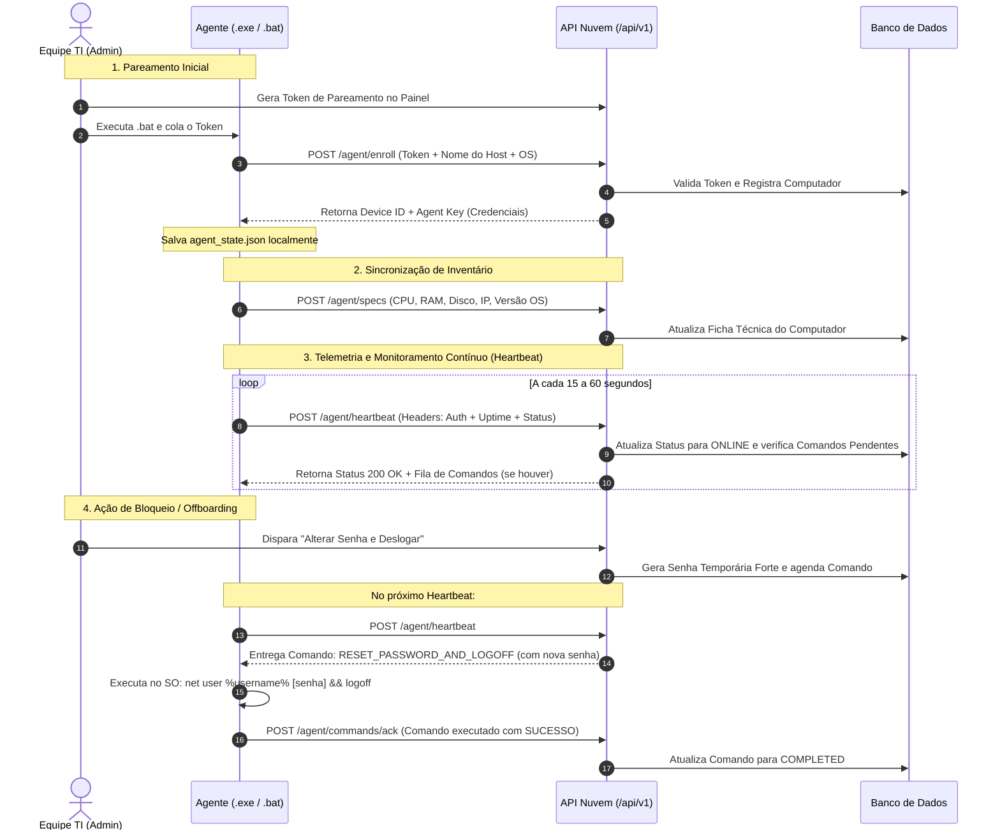

# Documentação Técnica e Arquitetura: Ublock RMM Endpoint Agent

Este documento apresenta a arquitetura, o fluxo de execução dos arquivos no endpoint (`.bat`, `.exe`, `.py`, `.sh`) e o protocolo de comunicação com o servidor em nuvem do ecossistema **Ublock RMM**.

---

## 1. Visão Geral da Arquitetura

O sistema é composto por três camadas principais:
1. **Endpoint (Dispositivo Monitorado):** Computador do colaborador (Windows, Linux ou macOS).
2. **API Central em Nuvem (Backend):** Servidor FastAPI (Python) hospedado em nuvem (Render) com banco PostgreSQL gerenciado (Supabase).
3. **Painel Web de Gestão (Frontend):** Interface React / Vite utilizada pela equipe de TI/Segurança.

```
+-----------------------------------------------------------+
|               PAINEL WEB (Equipe de TI)                   |
|       - Inventário de Máquinas  - Fila de Comandos        |
|       - Ações de Bloqueio       - Visualização de Senhas  |
+-----------------------------+-----------------------------+
                              | HTTPS REST
                              v
+-----------------------------------------------------------+
|               BACKEND CENTRAL (Render + Supabase)         |
|   /api/v1/agent/enroll   | /api/v1/agent/heartbeat        |
|   /api/v1/agent/specs    | /api/v1/agent/commands/ack     |
+-----------------------------+-----------------------------+
                              ^
                              | HTTPS REST (Polling Seguro)
                              |
+-----------------------------+-----------------------------+
|               DISPOSITIVO CLIENTE (Endpoint)              |
|                                                           |
|  [Instalação & Startup]     [Execução & Telemetria]       |
|   .bat / .sh                 ublock-agent.exe / .py       |
|   (ou silent-agent.vbs)      - Coleta Hardware & Uptime   |
|                              - Polling de Comandos        |
|                              - Ações Locais (net user, etc)|
+-----------------------------------------------------------+
```

---

## 2. Papel de Cada Arquivo no Endpoint

| Arquivo / Formato | Função Principal | Responsabilidade |
| :--- | :--- | :--- |
| **`.bat` (Windows)** *(ex: `instalar-agente-24h.bat`)* | **Instalador & Orquestrador de Inicialização** | - Valida privilégios administrativos (`RunAs Administrator`).<br>- Cria diretório protegido `C:\Program Files\UblockAgent`.<br>- Copia o binário executável e recebe o token de pareamento.<br>- Registra persistência no Registro do Windows (`Run` / VBS invisível) para iniciar sozinho no boot 24/7. |
| **`.exe` (Windows)** *(ex: `ublock-agent.exe`)* | **Agente Compilado e Autocontido** | - Gerado via PyInstaller a partir do código fonte Python.<br>- Não requer que o computador tenha Python instalado.<br>- Executa o pareamento, coleta métricas do sistema e executa ações de contenção em segundo plano. |
| **`.py` (Multiplataforma)** *(ex: `run-agent-client.py`)* | **Código-Fonte Central do Agente** | - Lógica central de negócio.<br>- Em ambiente de desenvolvimento ou em Linux/macOS, pode ser executado diretamente pelo interpretador Python nativo.<br>- Gera o arquivo de credenciais local `agent_state.json`. |
| **`.sh` (Linux / macOS)** *(ex: `instalar-agente-linux.sh`)* | **Instalador Unix / Daemon** | - Linux: Cria serviço no **systemd** (`ublock-agent.service`).<br>- macOS: Cria serviço no **LaunchDaemon** (`com.ublock.agent.plist`). |
| **`.vbs` (Windows)** *(ex: `silent-agent.vbs`)* | **Wrapper Invisível (Zero Janelas)** | - Chamado na inicialização do Windows para executar o `.exe` sem abrir console preto/prompt de comando na tela do usuário. |

---

## 3. Ciclo de Vida e Fluxo de Comunicação

A comunicação é **sempre originada pelo cliente em direção à nuvem** via **HTTPS (porta 443)**, garantindo que o agente funcione mesmo atrás de roteadores domésticos, NAT, CGNAT e firewalls corporativos sem precisar abrir portas de entrada no roteador.



---

## 4. Detalhamento dos Componentes Operacionais

### 4.1. Como o `.bat` atua no Windows
1. **Elevação:** Testa se possui permissões de Administrador. Se não tiver, auto-solicita através do comando PowerShell UAC.
2. **Implantação:** Copia o binário para `%ProgramFiles%\UblockAgent\ublock-agent.exe`.
3. **Pareamento Único:** Roda o agente no modo `--enroll-only` com o código fornecido, que bate na rota `/agent/enroll` e gera o `agent_state.json`.
4. **Persistência Silenciosa:** Escreve um script `silent-agent.vbs` e cadastra no registro do sistema (`HKLM\...\Run` e `HKCU\...\Run`), garantindo que o agente execute mesmo após reinicializações, sem abrir janelas.

### 4.2. Como o `.exe` / `.py` atua internamente
1. **Carregamento de Estado:** Lê o arquivo `agent_state.json` com `device_id` e `agent_key`.
2. **Módulo Coletor de Hardware:**
   - Detecta modelo do processador, total de núcleos, memória RAM, capacidade de disco e espaço livre.
   - Identifica usuário ativo localmente (`os.getlogin()`, `%username%` ou sessões via WMI/whoami).
3. **Módulo de Comunicação:**
   - Realiza requisições HTTPS criptografadas.
   - Injeta cabeçalhos de segurança: `X-Device-ID` e `Authorization: Bearer <agent_key>`.
4. **Módulo de Execução de Comandos (Contenção & Segurança):**
   - Recebe payloads JSON instruindo a ação.
   - **Exemplo de Offboarding (Windows):** Executa nativamente `net user <usuario> <senha_gerada>` e na sequência força o encerramento da sessão com `shutdown.exe /l /f`.
   - **Exemplo Linux / macOS:** Executa `chpasswd` / `dscl` e `pkill -KILL -u <usuario>`.
   - Devolve o log de saída (stdout/stderr) para a nuvem confirmando a execução.

---

## 5. Resumo para Apresentação Executiva (Slides / Pitch)

- **Instalação Rápida (1 Clique):** A TI apenas executa o script `.bat` (ou `.sh`) e insere o código de pareamento do painel. A configuração leva menos de 1 minuto.
- **Leve e Silencioso:** O `.exe` roda em segundo plano consumindo menos de 25MB de RAM e 0% de CPU em repouso. Não exibe ícones na bandeja nem telas para o colaborador final.
- **Segurança e Conformidade:** 
  - Comunicação 100% criptografada via HTTPS/TLS.
  - O agente não abre portas na máquina (imune a varreduras externas).
  - Em casos de demissão ou incidente de segurança, o comando de bloqueio altera a senha local e encerra a sessão imediatamente, deixando a máquina bloqueada e a nova credencial disponível apenas para os administradores no painel web.
